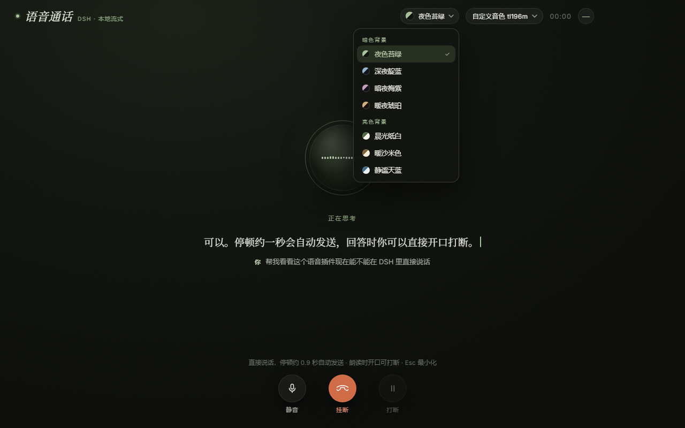
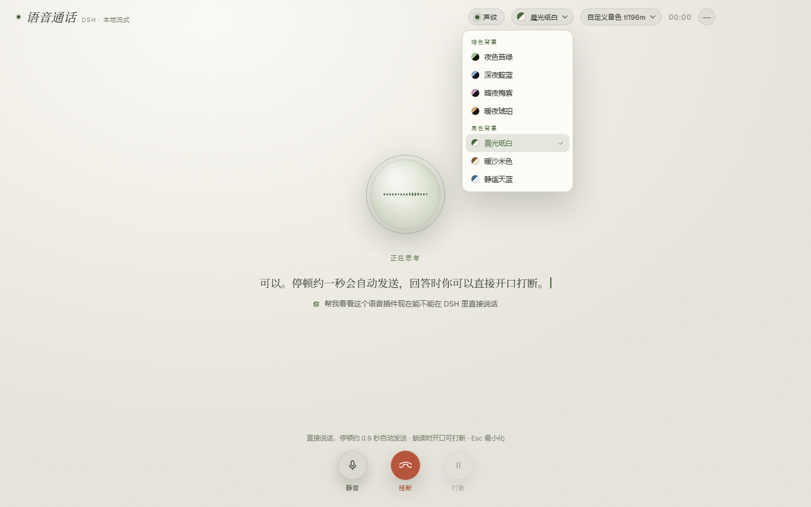
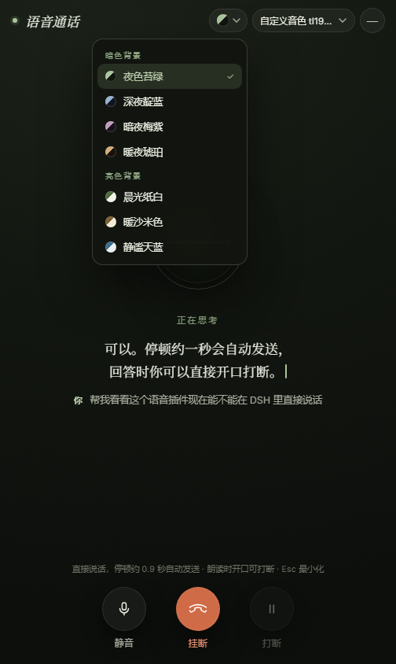

# dsh-plugin-voice-local

**DeepSeek Harness（DSH）本地流式语音插件**：TTS + ASR 全在宿主进程内跑，不 spawn 独立进程、不另起端口、不走云语音 API。点一下输入框的 🎙，就能在全屏通话界面里跟 DSH 说话——它边流边读，你随时开口打断。

[](https://www.npmjs.com/package/dsh-plugin-voice-local)
[](LICENSE)
[](https://github.com/deepseek-ai)



| 亮色主题（晨光纸白） | 手机窄屏（响应式） |
|---|---|
|  |  |

## 功能

- **全屏通话界面**：说话 → 停顿约 0.9s 自动发送 → 回复流式字幕 + 语音朗读 → 开口可打断。
- **7 套背景主题**：暗色 4 套（夜色苔绿 / 深夜靛蓝 / 暗夜梅紫 / 暖夜琥珀）+ 亮色 3 套（晨光纸白 / 暖沙米色 / 静谧天蓝）。选择立即生效并记忆；下拉框、字幕、球体配色一起切换。
- **可换模型**：TTS / ASR 都是模型注册表——往目录里丢模型即可出现，支持热切换，不重启宿主。
- **模型下载器**：`model.json` 声明下载清单，界面内显示进度；断点 `.part` + SHA256 校验；失败可重试。
- **本地优先**：模型、音频、文本都不出本机；路由仅回环地址可用，并做 Origin 校验。
- **输入框小语音条**：不打开全屏时也能看电平、字幕、结束/关闭；颜色跟随 DSH 主题变量。
- **响应式**：桌面 / 窄窗 / 手机浏览器均可用；安全区、触控尺寸、横屏矮窗都有适配。

## 环境要求

| 项 | 要求 |
|---|---|
| DSH | `>=0.2.0 <0.3.0-0`（已在桌面 0.2.2-rc.1 实测） |
| Node | `>=20`（宿主自带；桌面端无需另装） |
| 模型 | 至少一个 TTS（朗读）或流式 ASR（听写）；建议两者都配 |

## 快速开始

1. 安装插件（见下一节），刷新 DSH 页面，输入框右侧出现 🎙。
2. 准备模型：把模型目录放到 `$DSH_HOME/voice-local/models/` 下（结构见[模型](#模型)），或在通话界面的「模型」下拉里点缺模型的条目直接下载。
3. 点 🎙 → 说话。首次会请求麦克风权限。

> 只配 ASR 也能用：插件会退化为「语音输入」，不朗读回复；只配 TTS 则用于手动朗读测试。

## 安装

**方式 A：DSH 插件页（推荐）**  
设置 → 插件 → 从本地路径 / tarball 安装 `dsh-plugin-voice-local-<version>.tgz`，确认启用后刷新页面。

**方式 B：CLI**

```bash
dsh plugin --profile <profile> add ./dsh-plugin-voice-local-0.8.3.tgz
# 或从 npm
dsh plugin --profile <profile> add dsh-plugin-voice-local
```

> 客户端 bundle 有缓存：升级后需要**刷新宿主页面**（F5）才能加载新 UI；host 侧会自动热更新。

## 模型

模型**不随 npm 包分发**。插件启动后按顺序探测：

1. 配置里的显式路径（`ttsOnnx` / `asrStreamDir` / `sensevoiceDir`，旧配置兼容）
2. 环境变量 `VOICE_TTS_ONNX` / `VOICE_ASR_STREAM_DIR` / `VOICE_SENSEVOICE_DIR`
3. `dataRoot` 标准目录（默认 `$DSH_HOME/voice-local`，可用 `VOICE_DATA_ROOT` 覆盖）
4. standalone 项目目录（`onnx_out/tl196m_dyn.onnx`、`models/sherpa-onnx-streaming-*`、`xiaozhi/.../sensevoice`）

### 目录结构

```text
$DSH_HOME/voice-local/
└── models/
    ├── tts/
    │   └── melo-zh/                  # 每个子目录一个 TTS 模型
    │       ├── model.json            # 可选；省略则按文件特征探测
    │       ├── model.onnx
    │       ├── tokens.txt
    │       └── lexicon.txt
    └── asr/
        ├── streaming/<id>/           # 流式识别（实时字幕），必需
        │   ├── model.json
        │   ├── tokens.txt
        │   ├── encoder*.onnx
        │   ├── decoder*.onnx
        │   └── joiner*.onnx
        └── final/<id>/               # 整句定稿（更准、带标点），可选
            ├── model.json
            ├── model*.onnx
            └── tokens.txt
```

### `model.json`

```jsonc
{
  "id": "melo-zh",
  "name": "MeloTTS 中文",
  "engine": "sherpa-offline-tts",        // TTS：vits2-onnx | sherpa-offline-tts
  "type": "vits",                        // sherpa: vits | melo | piper | matcha | kokoro | kitten
  "sampleRate": 44100,
  "files": { "model": "model.onnx", "tokens": "tokens.txt", "lexicon": "lexicon.txt" },
  "options": { /* 引擎参数；sherpa 引擎支持 "sherpa": {...} 直接透传 */ },
  "download": [                          // 可选：界面内下载
    { "url": "https://example.com/model.onnx", "path": "model.onnx", "sha256": "…", "bytes": 123456 }
  ]
}
```

ASR 的 `model.json` 额外支持 `role`（`streaming` / `final`）、`type`（流式 `transducer`；定稿 `sense_voice` / `whisper` / `paraformer` / `transducer` / `nemo_ctc`）。字段全部可省，省略时按文件名自动探测。

### 模型许可

模型权重许可与代码 MIT **分开**。MeloTTS 为 MIT；SenseVoice 权重为 FunASR Model License 1.1；sherpa-onnx 官方模型多为 Apache-2.0；示例音色 tl196m 为 CC BY-NC-SA 4.0。详见 [THIRD_PARTY_NOTICES.md](THIRD_PARTY_NOTICES.md) 与 [docs/models.md](docs/models.md)。**重新分发前请自行核对许可与署名要求。**

仓库 [`examples/models/`](examples/models/) 提供两个可直接下载的示例清单：MeloTTS 中文（MIT）与 tl196m（作者自训，CC BY-NC-SA 4.0）。权重发布在 [Releases · models-v1](https://github.com/god1sdfghjkl/dsh-plugin-voice-local/releases/tag/models-v1)。

## 配置（`cordis.patch.yml` 的 `config`）

| 键 | 默认 | 说明 |
|---|---|---|
| `basePath` | `/voice-local` | 路由前缀 |
| `dataRoot` | `$DSH_HOME/voice-local` | 模型数据根目录 |
| `ttsModelsDir` | `$dataRoot/models/tts` | TTS 模型目录（每子目录一个模型） |
| `ttsModel` | `''` | 默认 TTS 模型 id；空 = 取第一个可用 |
| `ttsOnnx` / `ttsConfig` | `''` | 旧方式：直接指 `.onnx` / `config.json`（兼容保留） |
| `asrModelsDir` | `$dataRoot/models/asr` | ASR 模型目录（`streaming/` 与 `final/`） |
| `asrModel` / `asrFinalModel` | `''` | 默认流式 / 定稿 ASR 模型 id |
| `asrStreamDir` / `sensevoiceDir` | `''` | 旧方式：直接指模型目录（兼容保留） |
| `sr` | `44100` | 旧 `ttsOnnx` 方式的兜底采样率 |
| `ttsThreads` / `asrThreads` | `4` / `1` | 推理线程数 |
| `autoStart` | `true` | 插件加载即预热模型 |
| `llmTap` | `true` | tap `llm/stream` 自动朗读 |
| `firstSegmentChars` / `maxSegmentChars` | `6` / `16` | 首句 / 后续句长度 |
| `speed` | `1` | 语速倍率 |
| `vadThreshold` | `0.012` | 16k RMS 语音门限（自动断句） |
| `autoEndSilenceMs` | `900` | 说完停顿多久自动提交 |
| `minSpeechMs` | `200` | 至少说多久才算一句 |
| `bargeIn` / `bargeInThreshold` | `true` / `0.025` | 朗读期间是否允许开口打断及门限 |

## 使用

- **通话界面**：点 🎙 打开；—（或 `Esc`）最小化但**通话不中断**；挂断 = 结束语音模式。
- **背景主题**：顶栏左侧「主题」按钮（模型按钮左边），暗色/亮色分组，选择后立即切换并记住。
- **换模型**：顶栏「模型」下拉，分组显示 TTS / 流式 ASR / 定稿 ASR；缺模型的条目会显示「可下载 xxx MB」，点一下开始下载。
- **静音 / 打断**：底部按钮；朗读时开口也能打断。

## HTTP 接口（同源，仅回环）

| 方法 | 路径 | 作用 |
|---|---|---|
| GET | `/voice-local/status` | 引擎状态、模型路径、版本、配置 |
| GET | `/voice-local/models` | 模型目录（TTS / ASR 角色、可用性、下载摘要） |
| POST | `/voice-local/models/use` | 热切换模型：`{kind:'tts'\|'asr', id, role?}` |
| POST | `/voice-local/models/fetch` | 开始下载模型（SSE 进度） |
| GET | `/voice-local/stream?voice=1` | SSE：`asr` / `tts` / `assistant` / `model` 事件 |
| POST | `/voice-local/asr/start` \| `/asr/feed` \| `/asr/final` | 流式识别（PCM16LE @16k mono） |
| POST | `/voice-local/speak` | 文本转 WAV（手动测试用） |
| POST | `/voice-local/cancel` | 打断当前 TTS |
| GET | `/voice-local/assets/*` | 内置字体等静态资源 |

## 架构

- **host 半**（`lib/index.js`）：Cordis 插件，`inject ['webServer']`；模型注册表 + 下载器 + `engine-manager`，在 `worker_threads` 里跑 onnxruntime-node / sherpa-onnx；tap `llm/stream` 做流式切句并广播 TTS 音频。
- **client 半**（`lib/client.js`）：DSH 客户端 bundle（`window.__ModuleLoader__` + `slots`），输入框语音条 + 全屏覆盖层；AudioWorklet 16k 重采样 + VAD → `/asr/feed`；TTS PCM16 经 SSE 播放。
- **安全**：回环地址 + Origin 校验 + 请求体大小限制；模型下载校验 SHA256；不写系统目录。

## 手机 / dsh-go

- 浏览器/手机端**现在就能用**：`client.js` 已做响应式（安全区、≥44px 触控、窄屏顶栏、矮窗横屏）。
- 手机浏览器访问需要 **HTTPS 或 localhost** 才能拿到麦克风；局域网 `http://192.168.x.x` 会被 Chrome 拒绝。推荐 Tailscale / Caddy 反代或 `dsh web` 的本机模式。
- 开源手机端 **dsh-go**（[ccch1mneyyy/dsh-go](https://github.com/ccch1mneyyy/dsh-go)，Flutter/Android）有三种接法：网页版/网页岛（复用现有 UI，前提是 WebView 转发麦克风权限）、独立 HTTPS PWA 旁路、原生 `dshGo` 清单轻量集成。当前 WebView 麦克风仍有上游 issue（[#60](https://github.com/ccch1mneyyy/dsh-go/issues/60)），详细对比与落地步骤见 [docs/mobile.md](docs/mobile.md)。

## 开发与测试

```bash
npm test                 # 全量（需要本机模型；否则模型相关用例会跳过）
node test/parity.mjs     # 文本前端与参考实现逐 token 对齐
node test/models-smoke.mjs
node test/downloader-smoke.mjs
node test/client-smoke.mjs   # 假 DOM/EventSource，验证 UI 与主题
node test/asr-smoke.mjs      # 需 VOICE_ASR_DIR / VOICE_SENSEVOICE_DIR
node test/host-smoke.mjs     # 需示例模型或 VOICE_* 环境变量
```

设计预览（不依赖 DSH）：

```bash
node docs/preview/preview-overlay.mjs     # http://127.0.0.1:57999
# ?theme=day-paper  切换主题；?menu=theme 打开主题菜单；?debug 看断点尺寸
```

模型发布工具（零依赖）：

```bash
node scripts/model-manifest.mjs --dir <模型目录> --base-url <下载根地址>   # 生成 download 清单
node scripts/split-model.mjs --file <大文件> --out-dir <分段目录> --base-url <地址> --chunk-mb 16
```

## 常见问题

- **点了 🎙 没反应 / 没声音**：先看 `/voice-local/status` 的 `lastError`；再看是否授予麦克风权限、页面是否 HTTPS/localhost。
- **模型列表里没有我的模型**：确认 `model.json` 或文件名特征能识别，且目录位于 `models/tts/<id>` 或 `models/asr/{streaming,final}/<id>`。
- **下载失败**：检查 `model.json` 的 `download[].url` 与 `sha256`；国内网络可换 ModelScope/HF 镜像。
- **升级后界面没变**：客户端 bundle 有缓存，刷新页面（F5）。
- **内存/速度**：sherpa WASM 默认单线程；`ttsThreads` 可调。不要同时加载过多模型，按需热切换。

## 许可与致谢

- 本插件代码：[MIT](LICENSE)。
- 第三方代码/字体/模型：[THIRD_PARTY_NOTICES.md](THIRD_PARTY_NOTICES.md)。
- 感谢 dsh-voice-mode（AudioWorklet 重采样）、dsh-talk（VAD 纯函数）、sherpa-onnx、onnxruntime、MeloTTS 与 FunASR/SenseVoice 等开源项目。
- 设计参考：dsh-live-voice、DSH 官方插件（仅参考形态，未复制代码）。

## 版本

当前 `0.8.3`：顶栏上移 + 7 套背景主题 + 自绘下拉 + 模型下载器（支持分段/断点校验）+ 手机响应式；修复标题栏拖拽区吞点击。变更记录见 [CHANGELOG.md](CHANGELOG.md)。